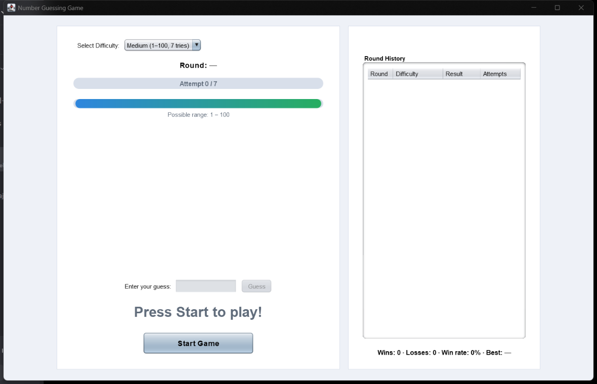
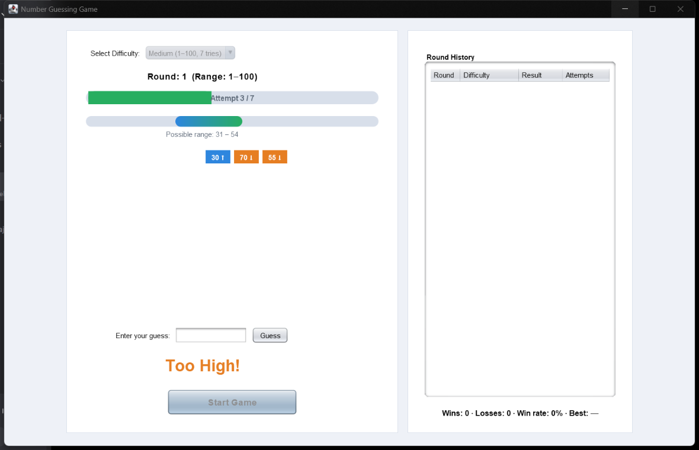
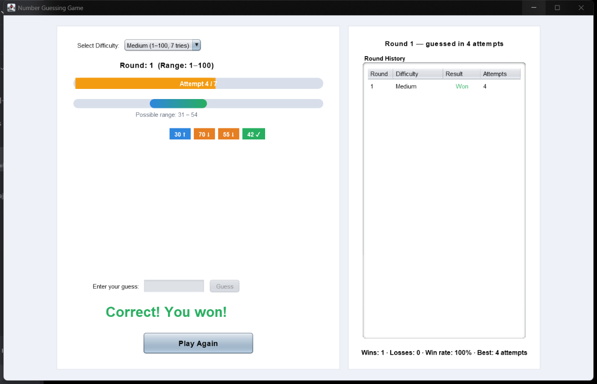
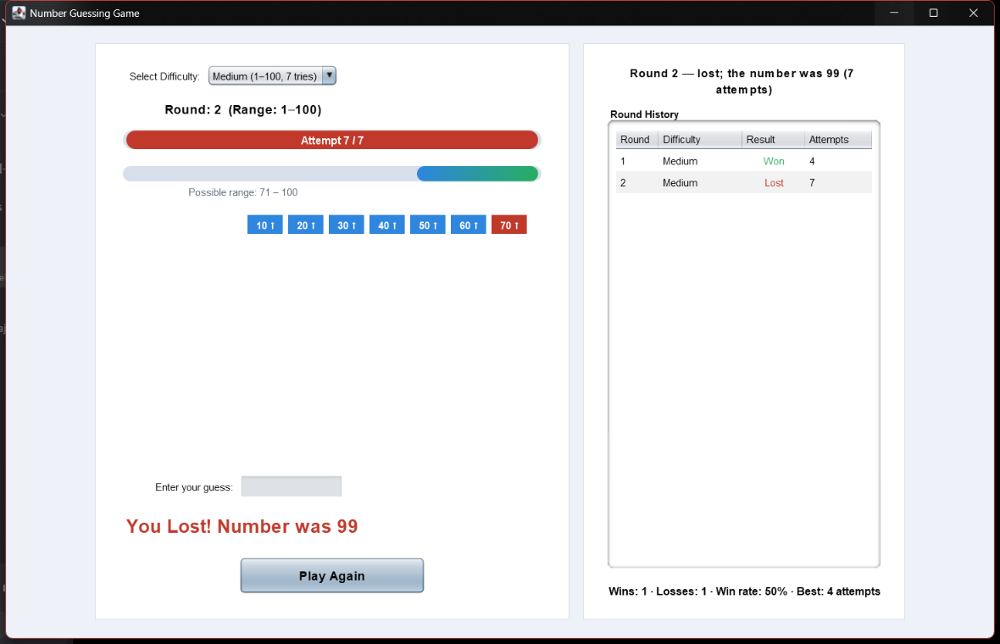
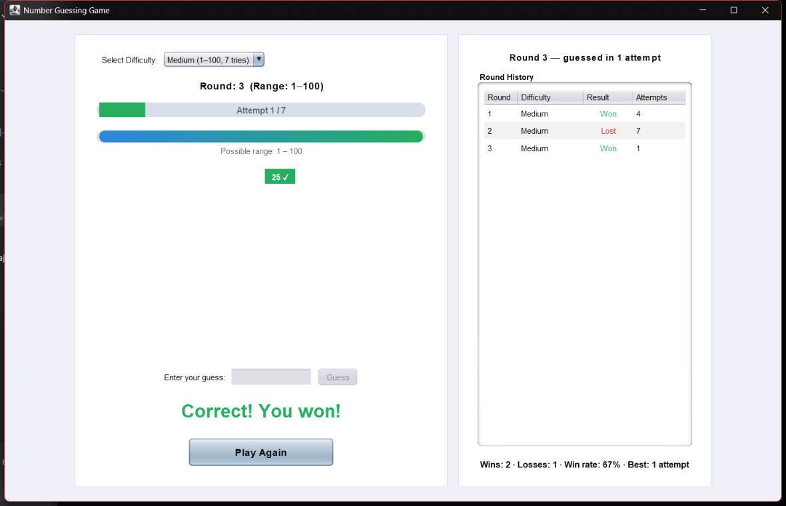

# Number Guessing Game (Java Swing)

**Oasis Infobyte Internship (OIBSIP) — Java Development, Task 2**

A desktop number guessing game written in Java Swing. The computer picks a random number and you try to guess it. After each guess you get a "Too High!" or "Too Low!" hint, and you have a limited number of attempts. The game keeps a history of every round you play.

---

## Screenshots

| Start Screen | Gameplay (Hints) |
|---|---|
|  |  |

| Correct Guess | You Lost |
|---|---|
|  |  |

**Round History across multiple rounds:**



---

## Features

### Core Requirements
- [x] **Random number generation**: a new secret number every round (1–100 on Medium)
- [x] **Guess input**: type a guess in a `JTextField` and press **Guess** or **Enter**
- [x] **Hints after each guess**: `Too High!`, `Too Low!`, or `Correct!`
- [x] **Attempt counter**: attempts left are always on screen
- [x] **Attempt limit**: when you run out, the game shows `You Lost!` and the secret number
- [x] **Play Again**: start a new round as soon as one ends
- [x] **Score tracking**: each round is logged as `Round X — guessed in Y attempts`

### Bonus: Difficulty Levels
| Difficulty | Range | Max Attempts |
|---|---|---|
| Easy   | 1 – 50  | 10 |
| Medium | 1 – 100 | 7  |
| Hard   | 1 – 200 | 5  |

### Extras
- **Possible range display**: shows the range that can still contain the number, updated after every guess
- **Past guesses list**: shows every guess made in the current round
- **Input checks**: non-numbers and guesses outside the range are rejected and don't use up an attempt
- **Change difficulty between rounds**: pick a new level before pressing Play Again

---

## Tech Stack
- **Language:** Java (JDK 8 or newer)
- **GUI:** Java Swing
- **Random numbers:** `java.util.concurrent.ThreadLocalRandom`
- **Pattern:** Model–View–Controller (MVC)

---

## Project Structure

```
Java-Task2-NumberGuessingGame/
├── src/main/java/com/guessgame/
│   ├── Main.java                    # Entry point; starts the Swing UI
│   ├── controller/
│   │   └── GameController.java      # Connects button and input events to the model and updates the view
│   ├── model/
│   │   ├── Difficulty.java          # Enum: EASY, MEDIUM, HARD (range and attempt limit)
│   │   ├── GameModel.java           # Game logic and state (no UI code)
│   │   └── GuessResult.java         # Enum: TOO_LOW, TOO_HIGH, CORRECT, OUT_OF_RANGE, ...
│   └── view/
│       └── GameView.java            # Swing window and components
├── screenshots/                     # Screenshots of the game
├── .gitignore
└── README.md
```

**How the MVC layers work together:**
- **Model** (`GameModel`): stores the secret number, attempts, round number and past guesses. Each guess returns a `GuessResult`. It doesn't depend on Swing.
- **View** (`GameView`): builds the window and enables or disables controls depending on the game state.
- **Controller** (`GameController`): handles user actions, calls the model, and turns each result into text on screen.

---

## How to Run

### Prerequisites
- Java JDK 8 or newer installed (`java -version` and `javac -version` should both work)

### Compile and Run (Command Line)

From inside the `Java-Task2-NumberGuessingGame` folder:

**Linux / macOS / Git Bash**
```bash
javac -encoding UTF-8 -d out $(find src -name "*.java")
java -cp out com.guessgame.Main
```

**Windows (PowerShell)**
```powershell
javac -encoding UTF-8 -d out (Get-ChildItem -Recurse -Filter *.java src).FullName
java -cp out com.guessgame.Main
```

> `-encoding UTF-8` makes sure dash characters such as `–` and `—` display correctly, especially on Windows.

### Run from an IDE
1. Open the folder in IntelliJ IDEA, Eclipse, or VS Code (with the Java Extension Pack).
2. Mark `src/main/java` as the source root if your IDE doesn't detect it.
3. Run `com.guessgame.Main`.

---

## How to Play
1. Choose a difficulty: **Easy**, **Medium**, or **Hard**.
2. Click **Start Game**.
3. Type a number and press **Guess** (or **Enter**).
4. Use the **Too High!** / **Too Low!** hints and the **Possible range** display to narrow it down.
5. Find the number before your attempts run out.
6. When the round ends, the result is added to **Round History**. Click **Play Again** to start another round, and change the difficulty first if you like.

---

## Author
**Yuvraj Sarathe**
Java Development Intern, Oasis Infobyte
GitHub: [@Yuvraj-Sarathe](https://github.com/Yuvraj-Sarathe)